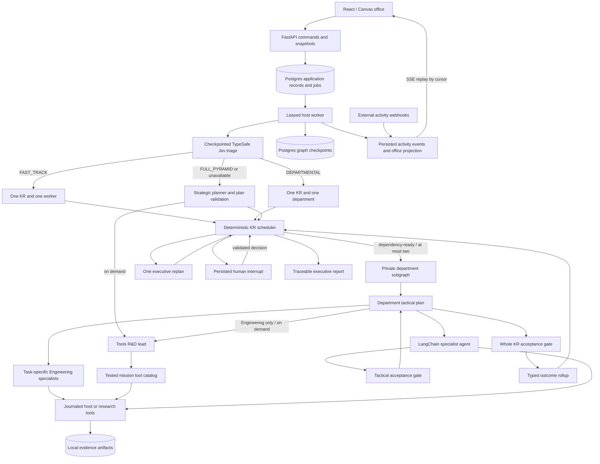

# Runtime architecture

## Boundary rules

The executive stores JSON contracts, not specialist transcripts. A department receives its constitution, versioned KR, approved dependency deliverables, and bounded feedback. A worker receives its tactical assignment and relevant inputs. Department outputs are typed KR outcomes. Only department approval updates executive KR progress to passed.

Checkpoints use the run ID as `thread_id`. Nested graphs inherit per-invocation persistence, preserving in-flight private work without carrying old assignments into a new KR. Keyed reducers merge concurrent results idempotently.

The worker owns one execution lease and a session advisory lock. Application jobs, graph checkpoints, and operation records have distinct purposes: a lease dispatches work, a checkpoint restores graph progress, and the operation journal prevents replay of known completed tool effects. Arbitrary host commands with unknown outcomes require human review before retry.

## Acceptance gates

The model supplies structured assessment and evidence references. Python decides routing. Approval requires constitution compliance, every required criterion, score at least 0.8, substantive stored artifacts, integrity checks, valid Python syntax where applicable, and successful referenced command/syntax checks. A worker's confidence or a suggested `approve` action is insufficient.

Full-pyramid work shares the configured rework cycles between worker and department gates in a KR epoch, and an ordinary escalation can consume the run's single automatic replan. Fast-track and departmental work cap rework at one and do not automatically replan; worker handoffs use structural checks and the whole KR receives one semantic review per attempt. Fast-track bypasses both planning models and executive narrative synthesis. Its report is generated from approved outcomes and evidence. Constitution violations persist a governance halt and require review. Human context starts another epoch; a KR revision also changes its definition version and invalidates transitive dependent approvals.

Worker invocation and deliverable extraction share an `asyncio.wait_for` deadline, defaulting to one hour (3600 seconds) for new runs. Per-run `limits.worker_timeout` overrides support up to 3600 seconds. Saved run limits determine each invocation's actual deadline and remain in effect unless an operator explicitly updates them before resuming. Explicitly optional packages can return incomplete fallback evidence to the lead; final approval still requires the mandatory work and all KR criteria. A pending host command remains an unknown-side-effect blocker rather than an optional fallback.

Public model selections are immutable run snapshots; per-agent overrides select server-owned provider connections. Credentials never enter persisted selections. Regenesis serializes API mutations, cancels unfinished work, acquires the same worker guard as execution, then erases managed disk directories and database/checkpoint/store contents. This excludes external user workspaces and preserves migration schemas and server credentials.

Workspace model-call defaults use the existing settings table. Each model cap is independently a bounded positive integer or JSON `null` for unlimited; `null` remains distinct from omission. New API and CLI missions merge defaults only into omitted budget fields, preserving explicit per-run values, including unlimited selections. Each saved mission owns its global request budget and per-invocation agent-turn limit; extraction, reviews, and request retries count toward any finite global budget. Usage counters continue to increment when a model cap is removed. Removing a model cap does not remove worker/request/command deadlines, tool-call budgets, or revision limits. The office saves both budget keys, preserves finite drafts when toggling **No limit**, and keeps budget editing separate from model selection. Run-creation fingerprints retain explicit budget-field presence so omission, `null`, and an explicit schema-default value remain distinct. A legacy-fingerprint fallback replays submissions created before this feature without changing their saved limits. Regenesis clears the budget preference with other settings and restores the finite 100/12 defaults; no table migration is required.

## Error boundaries

Expected tool-input failures use `ExpectedToolInputError` at the point that interprets a model-supplied file, artifact, URL, directory or command timeout. The journal records those errors as completed results; a model can read the error and correct its call without cancelling parallel work. Unknown run records, persistence failures and raw programming exceptions retain their failure semantics. Identical parallel operation IDs share a per-host lock and reuse the recorded result; conflicting requests still stop for review.

Exa per-URL crawl/not-found failures and empty page text use the recoverable `ExaContentUnavailable` input/resource boundary. The journal completes that tool call with its error detail so the agent can choose another URL or reuse stored sources within the same budgets. These page failures do not abort the worker or request human review automatically. Exa authentication, quota, service, and response-schema failures retain resource-blocker semantics. The provider adapter neither rewrites the requested URL nor bypasses Exa with a direct HTTP request or a different provider.

External contracts and provider messages reject U+0000, unsupported Unicode surrogate code points, and non-finite JSON numbers before persistence. The tool journal records malformed requests using a fingerprint-only envelope and a completed input error without executing them. HTTP validation responses omit raw input and exception context. Valid Unicode, emoji, tabs, newlines and literal escape sequences remain supported. External result previews explicitly escape incompatible characters and display non-finite numbers as strings while original artifact bytes remain intact; database serialization does not silently rewrite requests or evidence.

Text outputs created through host commands can be explicitly snapshotted with `publish_file`. The journal records a bounded, nonempty UTF-8 file as a source artifact under the current work package and epoch, preserving its bytes and integrity hash. Publishing does not approve the output or replace verification; replay reuses the recorded snapshot rather than reading changed bytes again.

| Boundary | Expected failure behavior | Protected behavior |
| --- | --- | --- |
| Artifact, file and syntax tools | Missing/foreign/corrupt references, paging and path errors become actionable tool results | Missing run records and persistence failures propagate |
| URL and search-provider tools | Engineering reads actual bounded HTTP sources; Research and Tools R&D use the selected Exa or legacy MCP provider; network/content failures remain explicit tool errors or resource blockers | Cancellation, policy and budgets are not replaced by fallback content; Exa failures never silently select another provider |
| Command journal | Invalid pre-start input is recorded; repeated identical IDs execute once | Started commands with unknown or unrecorded effects remain pending until reviewed |
| Model adapter | Missing response choices/messages/function fields and invalid usage become sanitized provider errors | Internal `KeyError`, storage errors and unrelated `ValueError` are not silently retried |
| Graph services | Returned contract validation and typed resource escalations have explicit routes | Exceptions inside services are not confused with malformed returned JSON |
| HTTP, CLI and UI | Resource errors are 404/422; failed runs can retry saved work; artifact/read failures show visible recoverable messages | Mutation requests are not automatically repeated; cancelled/succeeded runs cannot retry |

Unexpected worker failures retain a class-only message and safe diagnostic frames (file basename, function, line and execution phase), excluding exception bodies, prompts and credentials. Recovery preserves usage and epoch counters. The worker checks uncertain commands before constructing services or resuming graph work.

Web-provider selection is server configuration: a configured `EXA_API_KEY` selects Exa search and contents by default, while installations without it retain legacy Z.AI MCP. `WEB_SEARCH_PROVIDER=exa|zai_mcp` explicitly selects one provider; `EXA_TIMEOUT` defaults to 30 seconds. Research and Tools R&D share this selection, including R&D work attached to an Engineering KR. Engineering's direct bounded HTTP URL reader remains separate. Provider changes preserve saved research artifacts and operation evidence; a failed Exa request does not silently fall back to MCP. Public settings expose only `{provider, configured}` in `web_search`, never keys, and the office displays this status without a save control.

## Office projection

Version 1 activity events are persisted with monotonically ordered cursors and source-scoped event IDs. Projection updates and event inserts commit together. The browser snapshots a cursor, then replays subsequent SSE events; duplicate events are ignored. Internal handoff events identify both agent endpoints and the KR, allowing animation to reflect real transfers.

Saved activity is fetched separately through `/api/events/history`, with newest-first pages and an exclusive `before` cursor. Run, raw agent ID, and source filters select the relevant history. The page includes a consistent reset generation and global cursor; a stale generation clears the client before it can display old records. The browser merges saved pages with live activity without projecting historical states or animating old handoffs. Agent history and stream history have independent pagination, so busy agents cannot evict another agent's records. PostgreSQL snapshot/history reads acquire table locks in the same order as reset to avoid reader/reset deadlocks.

External webhooks update external display identities only. They cannot change run records, approvals, or reviews. Engineering specialists and external integrations occupy separate paged desks, and every agent remains available in the searchable list. Canvas rendering, hit targets, and handoffs share one position resolver. Trusted specialist identity metadata survives later tool events and snapshot reloads; external metadata cannot create an internal agent identity.

## Dynamic specialists and tool development

Engineering tactical plans can include an immutable specialist definition in each work package: a display name, task-specific instructions, and an optional subset of existing Engineering execution tools. The core artifact protocol (`write_file`, `read_artifact`, `escalate_blocker`) remains available under narrowing; shell execution and other optional capabilities require selection. Python derives its identity from the run, KR, package, base role, and definition. The model cannot assign a privileged actor ID. The definition is persisted before execution in the department checkpoint. Notes, tool journals, handoffs, deliverables, and attempt records use the same identity; model selection inherits the saved base-role override. Research and triage retain their existing roles, and fast-track work adds no planning or R&D call.

Planner and Engineering lead have a bounded tool-enabled planning loop. Its final plan is validated locally, with a repair call only when its JSON fails validation. Planning journals include a canonical hash of the invocation context: unchanged checkpoint replay reuses completed work, while revised feedback or dependency inputs receive a distinct scope even if the provider reuses a tool-call ID. Only these two actors receive the R&D consultation binding, and the server independently validates the caller. The R&D lead cannot delegate further agents. Its research or tool-development work shares the original constitution and run budgets; a report or tool definition does not approve any KR.

Each specialist receives a server-authored assignment artifact with its exact identity and work definition. Verified public R&D consultation references from the current KR version or Planner accompany the assignment into review; private model history does not. Successful tool invocations record their definition, source hash, arguments, output, and execution receipts. Assignment metadata and materialized support files are excluded from substantive evidence checks. Each R&D consultation has an isolated managed workspace, including when the mission uses an external workspace.

The mission tool catalog uses existing immutable artifacts and operation journals, requiring no new database table. Registration is exclusive to the private R&D actor. It validates a self-contained JSON object schema, snapshots a nonempty Python source file, and requires a successful JSON-stdin/JSON-stdout subprocess example before publishing a definition. Invocations verify the definition, source hash, test evidence, run ownership, and arguments. Source is materialized in the caller's workspace and executed through HostTools, preserving cancellation, deadlines, command receipts, and unknown-effect review. Generated Python is never loaded into the harness interpreter. Each explicit registration has an immutable tool ID, and replay returns the recorded result. Regenesis clears the catalog with managed artifacts and journals.

## Operational limits

This is a trusted local host deployment with loopback networking and no authentication. Role-scoped interfaces and prompt boundaries govern orchestration, while shell tools retain the local account's operating-system permissions. Broad semantic constitution rules remain model assessments; this architecture does not claim sandbox enforcement.
