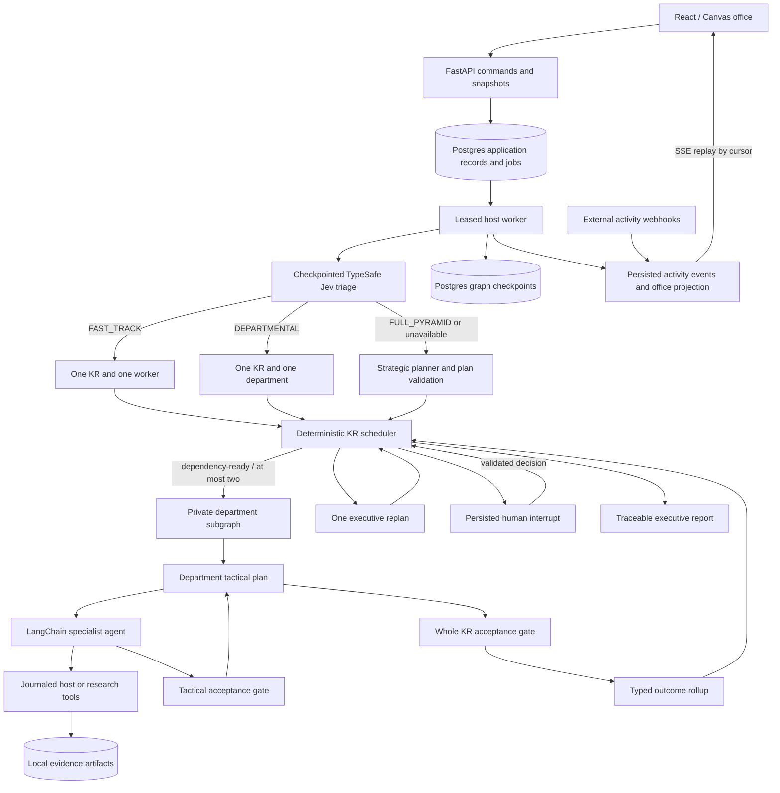

# Runtime architecture

## Boundary rules

The executive stores JSON contracts, not specialist transcripts. A department receives its constitution, versioned KR, approved dependency deliverables, and bounded feedback. A worker receives its tactical assignment and relevant inputs. Department outputs are typed KR outcomes. Only department approval updates executive KR progress to passed.

Checkpoints use the run ID as `thread_id`. Nested graphs inherit per-invocation persistence, preserving in-flight private work without carrying old assignments into a new KR. Keyed reducers merge concurrent results idempotently.

The worker owns one execution lease and a session advisory lock. Application jobs, graph checkpoints, and operation records have distinct purposes: a lease dispatches work, a checkpoint restores graph progress, and the operation journal prevents replay of known completed tool effects. Arbitrary host commands with unknown outcomes require human review before retry.

## Acceptance gates

The model supplies structured assessment and evidence references. Python decides routing. Approval requires constitution compliance, every required criterion, score at least 0.8, substantive stored artifacts, integrity checks, valid Python syntax where applicable, and successful referenced command/syntax checks. A worker's confidence or a suggested `approve` action is insufficient.

Full-pyramid work shares the configured rework cycles between worker and department gates in a KR epoch, and an ordinary escalation can consume the run's single automatic replan. Fast-track and departmental work cap rework at one and do not automatically replan; worker handoffs use structural checks and the whole KR receives one semantic review per attempt. Fast-track bypasses both planning models and executive narrative synthesis. Its report is generated from approved outcomes and evidence. Constitution violations persist a governance halt and require review. Human context starts another epoch; a KR revision also changes its definition version and invalidates transitive dependent approvals.

Worker invocation and deliverable extraction share a 60-second `asyncio.wait_for` deadline. Explicitly optional packages can return incomplete fallback evidence to the lead; final approval still requires the mandatory work and all KR criteria. A pending host command remains an unknown-side-effect blocker rather than an optional fallback.

Public model selections are immutable run snapshots; per-agent overrides select server-owned provider connections. Credentials never enter persisted selections. Regenesis serializes API mutations, cancels unfinished work, acquires the same worker guard as execution, then erases managed disk directories and database/checkpoint/store contents. This excludes external user workspaces and preserves migration schemas and server credentials.

## Office projection

Version 1 activity events are persisted with monotonically ordered cursors and source-scoped event IDs. Projection updates and event inserts commit together. The browser snapshots a cursor, then replays subsequent SSE events; duplicate events are ignored. Internal handoff events identify both agent endpoints and the KR, allowing animation to reflect real transfers.

External webhooks update external display identities only. They cannot change run records, approvals, or reviews. The fixed office has six external desks; further agents remain available in its searchable list.

## Operational limits

This is a trusted local host deployment with loopback networking and no authentication. Role-scoped interfaces and prompt boundaries govern orchestration, while shell tools retain the local account's operating-system permissions. Broad semantic constitution rules remain model assessments; this architecture does not claim sandbox enforcement.
